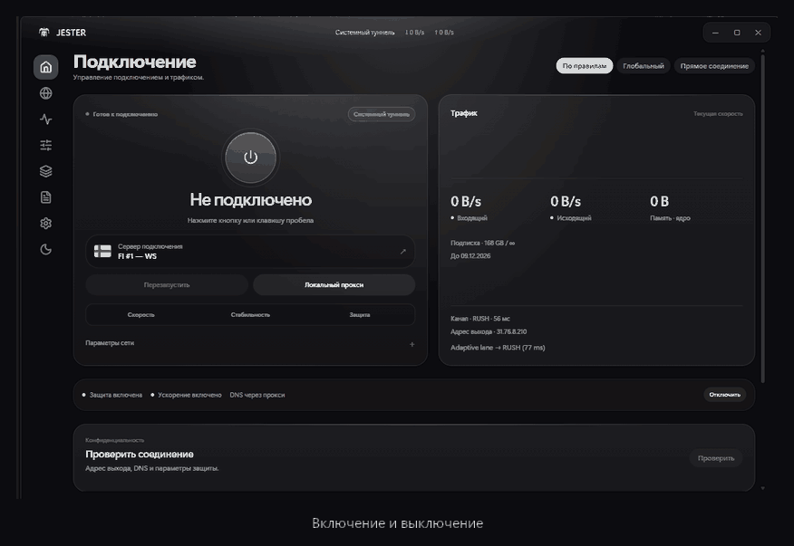

# Jester

Защищённое подключение для Android, Windows и Linux. На компьютере системный туннель и системный прокси можно включить вместе. На телефоне один режим — системный VPN.

<strong>Важно. Используйте только последнюю версию. Предыдущие релизы сохранены в истории и могут работать неправильно.</strong>

  

## 1.2.1

- Android: приложение ставится из APK. Ядро уже внутри, отдельно загружать его не нужно.
- На главном экране телефона ссылка подписки или QR, список серверов и пинг.
- Linux и Windows без смены режима: туннель и системный прокси по-прежнему включаются вместе.

Логика клиента на Rust. Окно на TypeScript, туннель поднимает mihomo.

## Возможности

- **Системный туннель** — трафик идёт через сетевой адаптер.
- **Системный прокси** — программы, которые пользуются системным прокси, идут через локальный порт. Можно включить вместе с туннелем.
- **Профили** — подписка или готовая конфигурация. Поддерживаются VLESS, VMess, Shadowsocks, Trojan, Hysteria2 и TUIC.
- **Маршрутизация** — по правилам, глобальный режим и прямое соединение.
- **Ускоренный канал** — приоритет быстрых протоколов. Сети Российской Федерации направляются напрямую.
- **Защита** — блокировка QUIC и STUN, DNS через туннель, случайный отпечаток TLS и тихий журнал.
- **Трей** — статус, сервер, туннель, системный прокси и импорт из буфера обмена.
- **Оформление** — цвета, скругление, стекло, боковая панель и шрифты.

## Скачать

Откройте [страницу релизов](https://github.com/78rayy192/jester-proxy-client/releases).

### Android

1. Скачайте **Jester-android.apk**.
2. Разрешите установку из файла и откройте APK.
3. На главном экране вставьте ссылку подписки или отсканируйте QR.
4. Выберите сервер и включите подключение. Система спросит разрешение на VPN.

Нужен Android 8 или новее. Настройки хранятся в памяти приложения.

### Linux

1. Скачайте **Jester-linux-x64.tar.gz**.
2. Распакуйте архив.
3. Запустите `jester`.

Нужен 64-bit Linux и WebKitGTK 4.1. Ядро при первом запуске загружается кнопкой «Загрузить ядро». Настройки хранятся в `~/.local/share/jester`.

### Windows

1. Скачайте **Jester-windows-x64.zip**.
2. Распакуйте архив.
3. Запустите `Jester.exe`.

Нужны Windows 10 или Windows 11, 64-bit. Отдельно ставить .NET не нужно. Графическая среда WebView2 в Windows 11 обычно уже есть. Для туннеля подтвердите запрос прав администратора.

## Первый запуск

На Android ядро загружать не нужно: вставьте подписку на главном экране и включите VPN.

На компьютере:

1. Нажмите **Загрузить ядро** и дождитесь завершения.
2. Добавьте профиль: ссылка подписки или вставка конфигурации.
3. Включите туннель, системный прокси или оба режима.
4. Запустите подключение. Пробел включает и останавливает его.

Если поставщик ограничивает число устройств, удалите неиспользуемое в его боте и обновите подписку.

На Windows настройки, профили и журнал хранятся в `%AppData%\Jester\`.

Импорт сохраняет проверку TLS-сертификатов, кроме явно заданного `insecure` / `allowInsecure`. Основные DNS-запросы могут идти через прокси. QUIC и STUN фильтруются в режиме «По правилам». Защита системного прокси при сбое касается приложений, которые используют системный прокси. Диагностика показывает адрес выхода и не подтверждает отсутствие утечек.
